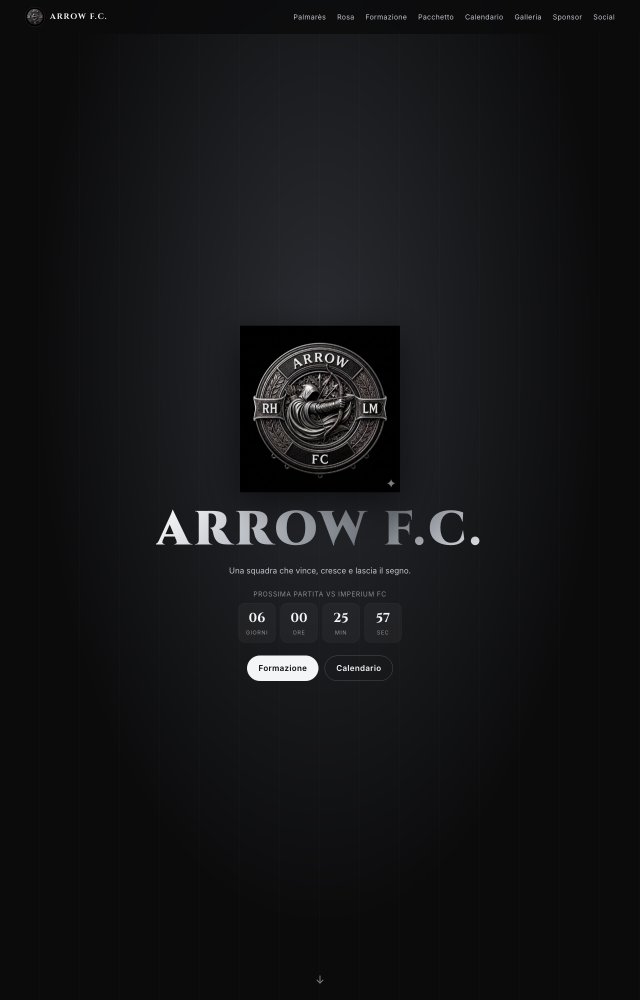

# Arrow F.C.

Il sito ufficiale di **Arrow F.C.**, squadra di Serie A LegaCalcio a 8 del Piemonte.



**Vai al sito:** https://arrowfc.it/

## Cosa contiene

- **Palmarès:** trofei e piazzamenti della squadra, con colori per vittoria, secondo posto e stagione in corso.
- **Rosa:** scheda di ogni giocatore con foto, numero di maglia, ruolo, presenze, gol e assist.
- **Formazione 3-3-1:** campo verde con le carte dei giocatori. I titolari e la panchina cambiano da soli, in gruppi da otto.
- **Apri pacchetto:** animazione stile FIFA che rivela un giocatore a caso, con scheda e coriandoli.
- **Calendario:** partite passate e future, con stemmi, orario, risultato e marcatori.
- **Collezione:** le foto scelte della squadra.
- **Galleria:** foto e video di partite, allenamenti e giocatori.
- **Sponsor e social:** i partner della stagione 2026/27 e i profili Instagram e TikTok.

## Pannello admin

Gli amministratori accedono con email e password, con account creati e controllati da Supabase. Dal pannello si gestiscono:
- partite, con risultato, marcatori, assist e presenze
- giocatori, con foto e ruolo
- galleria e collezione
- sponsor
- statistiche, calcolate in automatico dalle partite

## Come è fatto

Il sito è scritto in HTML, CSS e JavaScript, senza framework. I dati si leggono da un database Supabase, con una copia di sicurezza nel codice. Le foto sono salvate nello spazio di archiviazione di Supabase.

Per usare il sito in locale, avvia un server dalla cartella del progetto:

```bash
python3 -m http.server 8765
```

e apri http://localhost:8765/index.html
